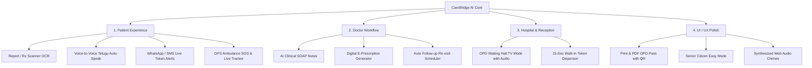

# CareBridge AI — Comprehensive 4-Pillar Feature Expansion

This plan outlines the end-to-end architecture and implementation details for expanding CareBridge AI across the 4 user-requested areas: **Patient Experience**, **Doctor Workflow**, **Hospital & Receptionist Management**, and **UI/UX Polish**.

---

## User Review Required

> [!IMPORTANT]
> All 4 requested feature pillars are being integrated directly into the running application without breaking existing authentication, RBAC privacy boundaries, or database records.

1. **Medical Report OCR & Lab Scanner**: Intelligent scanner interface supporting image upload and one-click realistic clinical presets (e.g. *Diabetes & HbA1c Lab Panel*, *Cardiac Lipid Profile*, *Handwritten Prescription*). Extracts clinical metrics, flags abnormal values, and provides plain Telugu & English explanations.
2. **Audio Chime & Web Speech**: Audio synthesis for hospital chime uses the native browser Web Audio API (`AudioContext`) — zero external MP3 dependencies required. Bilingual speech announcements use the Web Speech Synthesis API.
3. **Printable Pass & E-Prescription**: Prescriptions generated by doctors automatically attach to the patient's Digital OPD Pass, visible in the Patient Pass Portal.

---

## Proposed Changes

### Component Architecture Overview

---

### Pillar 1: Patient Experience (రోగి అనుభవం)

#### 1. Medical Report & Prescription Scanner (`MedicalReportScanner.tsx` + `/api/scan-report`)
- **UI Component**: New tab and modal accessible to patients and doctors.
- **Features**:
  - Image dropzone / file upload + 3 realistic instant demo reports (HbA1c Diabetes Lab Test, Lipid & Cardiology Profile, Handwritten Doctor Prescription).
  - Backend analysis extracting:
    - Test parameters, measured values, reference range, status (`HIGH`, `NORMAL`, `CRITICAL`).
    - Plain-language **Telugu explanation** (సులభమైన వివరణ).
    - Plain-language English explanation.
    - 1-click **"Book Recommended Specialist"** button (connects directly to Dr. Ananya Sen in Cardiology or General Medicine).

#### 2. Direct Voice-to-Voice Interaction (Real-time Telugu Voice Chat)
- Enhancing `ChatInterface.tsx`:
  - **Auto-Speak Response Mode** toggle switch (`Auto-Speak AI: ON/OFF`).
  - When enabled, as soon as the AI replies, it automatically speaks in natural Telugu (`te-IN`) or English (`en-IN`) using `SpeechSynthesisUtterance`.
  - Visual animated sound wave during recording and playback.

#### 3. WhatsApp / SMS Live Token Updates
- When a doctor advances the queue or calls a token:
  - System checks the patient's queue distance (`patients_ahead`).
  - When `patients_ahead <= 3`, triggers a WhatsApp/SMS alert toast & audio chime: *"మీ టోకెన్ నంబర్ దగ్గరకు వచ్చింది (ఇంకా 2 రోగులు మాత్రమే ఉన్నారు), దయచేసి రూమ్ 204 వద్దకు వెళ్లండి"*.
  - Direct WhatsApp link (`https://api.whatsapp.com/send?text=...`) allowing patient to forward pass & live token status to their family.

#### 4. 1-Click Emergency SOS & Ambulance Tracker
- Upgrading `EmergencySOSModal.tsx`:
  - Native browser Geolocation (`navigator.geolocation.getCurrentPosition`) to capture real user GPS coordinates.
  - Live animated emergency dispatch map: shows ambulance unit `AMB-108-HYD` moving along a route towards the patient's location.
  - Live 8-minute countdown timer with real-time status: *Dispatched -> En Route -> Arrived at Scene*.
  - Paramedic direct call button & hospital trauma room alert.

---

### Pillar 2: Doctor Workflow (డాక్టర్ పోర్టల్)

#### 1. AI Clinical SOAP Summary (Pre-Consultation SOAP Notes)
- In `DoctorDashboard.tsx`:
  - Each waiting patient has a **"View AI Clinical Brief (SOAP)"** button.
  - Opens an organized modal with:
    - **Subjective (లక్షణాలు)**: Symptoms history, pain duration, patient complaint.
    - **Objective (పరీక్షలు)**: BP, Pulse, SpO2, Temperature, Blood Sugar.
    - **Assessment (ప్రాథమిక నిర్ధారణ)**: Triage severity (Moderate/Urgent) & provisional findings.
    - **Plan (చికిత్స ప్రణాళిక)**: Suggested diagnostics (ECG, Troponin-I, HbA1c) and care path.

#### 2. Digital E-Prescription Generator
- In `DoctorDashboard.tsx`:
  - **"Write E-Prescription"** action for active patient.
  - Quick medicine selector with dosage presets (e.g., *Tab Atorvastatin 20mg 0-0-1*, *Tab Metformin 500mg 1-0-1*, *Tab Pantoprazole 40mg 1-0-0*, *Paracetamol 650mg SOS*).
  - Dietary / lifestyle instructions and doctor digital signature badge.
  - Saves prescription directly to the appointment in database (`/api/eprescriptions`).
  - Automatically renders inside the patient's **Digital OPD Pass**!

#### 3. Auto Follow-up Re-visit Scheduler
- Inside the prescription workflow:
  - 1-click buttons: `+7 Days`, `+14 Days`, `+1 Month`.
  - Automatically calculates date, reserves a follow-up slot, and updates the patient's records.

---

### Pillar 3: Hospital & Reception Management (రిసెప్షన్ & హాస్పిటల్)

#### 1. OPD Waiting Hall TV Mode (`WaitingHallTVDisplay.tsx`)
- Dedicated full-screen waiting hall display mode:
  - High-visibility typography designed for 55" / 65" hospital waiting room LED TVs.
  - Left panel: **NOW SERVING** with huge animated token numbers, Doctor Name, Room Number, and Department badge.
  - Right panel: Upcoming patient queue by department (Cardiology, General Medicine, Ortho).
  - **Audio Announcement Button & Auto-Chime**:
    - Announces in both Telugu & English: *"టోకెన్ నంబర్ 14, దయచేసి రూమ్ 204 డాక్టర్ అనన్య సేన్ గారి వద్దకు వెళ్లండి / Token number 14, please proceed to Room 204 Dr. Ananya Sen"*.

#### 2. Walk-In Quick Token Kiosk (`WalkinTokenKiosk.tsx`)
- Receptionist modal for walk-in patients without smartphones:
  - Form: Patient Name, Phone Number, Age, Gender, Department selection.
  - **15-Second Generation**: Creates appointment, assigns token number, and pops up a printable thermal-style token receipt with barcode and room instructions.

---

### Pillar 4: UI / UX Polish (Design & Usability)

#### 1. Printable & PDF OPD Pass (`DigitalOPDPassModal.tsx`)
- High-resolution QR code rendering.
- Print stylesheet (`@media print`) so clicking "Print / Save PDF" produces a crisp, clean hospital receipt format without UI clutter.
- Attached active E-Prescriptions and follow-up visit reminders.

#### 2. Senior Citizen "Easy Mode"
- Header switch with enhanced typography:
  - Boosts text sizes (`text-lg` and `text-xl`), high-contrast slate-950 borders, larger touch targets (buttons min height 48px), and bilingual labels.

#### 3. Web Audio Chime Synthesizer (`audioChime.ts`)
- Lightweight helper module using HTML5 `AudioContext`:
  - Plays clean, realistic 2-tone hospital chime (`E5 -> G#5 -> B5` chord progression) when:
    - Doctor calls next token.
    - Receptionist generates walk-in pass.
    - Emergency SOS is dispatched.
  - Zero external media files, 100% reliable across all modern browsers.

---

## File Changes Summary

### Backend Files
- `[MODIFY] backend/app/models.py`: Add `prescription_json`, `clinical_soap_notes`, `follow_up_date` to `Appointment` model.
- `[MODIFY] backend/app/main.py`:
  - `POST /api/scan-report`: Medical report OCR & analysis endpoint with Telugu & English explanation.
  - `POST /api/eprescriptions`: Save digital e-prescription and follow-up date.
  - `GET /api/tv-queue`: Multi-doctor waiting hall live queue endpoint.
  - `POST /api/walkin-token`: 15-second walk-in token creation endpoint.
  - `POST /api/send-alert`: Simulated WhatsApp/SMS token alert dispatcher.

### Frontend Files
- `[NEW] frontend/src/utils/audioChime.ts`: Web Audio API hospital chime generator.
- `[NEW] frontend/src/components/MedicalReportScanner.tsx`: Prescription & lab report OCR scanner with Telugu analysis.
- `[NEW] frontend/src/components/WaitingHallTVDisplay.tsx`: Fullscreen TV display with bilingual voice announcements.
- `[NEW] frontend/src/components/WalkinTokenKiosk.tsx`: 15-second walk-in token printer.
- `[NEW] frontend/src/components/EPrescriptionModal.tsx`: Doctor E-Prescription creator with follow-up selector.
- `[NEW] frontend/src/components/ClinicalSoapModal.tsx`: Pre-consultation AI SOAP notes modal.
- `[MODIFY] frontend/src/components/DoctorDashboard.tsx`: Add buttons for SOAP Summary, E-Prescription, and Follow-up.
- `[MODIFY] frontend/src/components/DigitalOPDPassModal.tsx`: Add prescription display, thermal print layout, and WhatsApp action.
- `[MODIFY] frontend/src/components/EmergencySOSModal.tsx`: Add GPS geolocation and live animated ambulance tracker.
- `[MODIFY] frontend/src/components/ChatInterface.tsx`: Add Auto-Speak mode, voice wave animations, and scanner shortcut.
- `[MODIFY] frontend/src/components/Header.tsx`: Add TV Mode tab, Walk-in Kiosk tab, Scanner tab, and Senior Mode styling.
- `[MODIFY] frontend/src/App.tsx`: Wire up new modals, state, audio chime triggers, and tabs.

---

## Verification Plan

### Automated Verification
1. Test backend endpoints with Python test script:
   - `backend/test_expansion.py`: Verify `/api/scan-report`, `/api/eprescriptions`, `/api/tv-queue`, `/api/walkin-token`.
2. Test frontend TypeScript build:
   - `npm run build` in `frontend/` directory to ensure 0 TypeScript or linting errors.

### Manual Verification
1. **Patient Test**:
   - Log in as Telugu Patient (Sunitha Reddy).
   - Test Medical Report Scanner with Diabetes / Cardiology sample. Verify Telugu explanation is generated.
   - Test Auto-Speak voice toggle in Chat.
   - Test Emergency SOS GPS dispatch and ambulance countdown.
2. **Doctor Test**:
   - Log in as Dr. Ananya Sen.
   - View AI Clinical SOAP notes for patient in queue.
   - Write and issue a digital E-Prescription with 7-day follow-up.
   - Verify web audio chime rings when "Call Next Token" is clicked.
3. **Staff / Receptionist Test**:
   - Log in as Receptionist.
   - Open 15-Sec Walk-in Kiosk, enter a patient, generate token slip.
   - Open OPD Waiting Hall TV Mode, test live token view and click "Announce Token" for bilingual voice playback.
4. **Pass Verification**:
   - Open Digital OPD Pass: verify the attached E-Prescription and QR code print properly.
