# CareBridge AI — 4-Pillar Feature Expansion Walkthrough

All four user-requested enhancement pillars have been designed, built, and verified end-to-end across the frontend and backend.

---

## 🌟 What Was Built

```mermaid
graph TD
    CB[CareBridge AI Platform] --> P1[1. Patient Experience]
    CB --> P2[2. Doctor Clinical Portal]
    CB --> P3[3. Hospital & Reception]
    CB --> P4[4. UI / UX Polish]

    P1 --> P1_1[Medical Report & Rx Scanner with Telugu AI]
    P1 --> P1_2[Auto-Voice Telugu Speech-to-Speech]
    P1 --> P1_3[WhatsApp & SMS Live Token Dispatch]
    P1 --> P1_4[GPS Geolocation 108 Ambulance Tracker]

    P2 --> P2_1[Pre-Consultation AI SOAP Brief]
    P2 --> P2_2[Digital E-Prescription Generator]
    P2 --> P2_3[Auto Follow-up Re-visit Scheduler]

    P3 --> P3_1[Waiting Hall TV Mode with Audio Announcements]
    P3 --> P3_2[15-Sec Walk-in Token Dispenser & Thermal Slip]

    P4 --> P4_1[Senior Citizen Easy Mode]
    P4 --> P4_2[Printable Digital OPD Pass with QR]
    P4 --> P4_3[Web Audio API Hospital Chimes]
```



---

### Pillar 1: Patient Experience (రోగి అనుభవం)

1. **Medical Report & Rx OCR Scanner** (`MedicalReportScanner.tsx` + `/api/scan-report`):
   - Supports file uploads (PDF/Image) or 3 instant 1-click clinical presets:
     - **Diabetes & HbA1c Panel** (Fasting 158 mg/dL, HbA1c 8.4%)
     - **Cardiac Lipid Profile** (Cholesterol 245 mg/dL, Triglycerides 210 mg/dL)
     - **Handwritten Doctor Prescription** (Metformin 500mg, Atorvastatin 20mg, Telmisartan 40mg)
   - Extracted metrics table with bounds and triage flags (`NORMAL`, `ELEVATED`, `HIGH RISK`).
   - Plain-Language medical interpretation with toggle for authentic **Telugu (సులభమైన వివరణ)** and **English**.
   - **Bilingual Voice Readout** button (`వినండి (Speak)`) to read findings aloud to patients.
   - 1-Click **"Book Specialist Slot Now"** linking directly to the recommended doctor.

2. **Real-time Telugu Auto-Speak Voice Interaction** (`ChatInterface.tsx`):
   - **Auto-Voice Toggle** (`🔊 Auto-Voice: ON/OFF`) right next to the mic in the chat interface.
   - When enabled, AI responses in Telugu or English are automatically spoken aloud using browser `SpeechSynthesis`.
   - Voice typing via Web Speech API with multilingual recognition (`te-IN` / `en-IN`).

3. **WhatsApp & SMS Live Token Updates** (`/api/send-alert` + `DoctorDashboard.tsx`):
   - When a doctor advances the queue or calls a token, live notifications are dispatched.
   - Interactive WhatsApp forwarding link on the Digital Pass for patients to share live queue status with family.

4. **1-Click Emergency SOS & GPS Ambulance Tracker** (`EmergencySOSModal.tsx`):
   - Native browser Geolocation API (`navigator.geolocation.getCurrentPosition`) captures real user GPS coordinates.
   - Live animated emergency dispatch radar: shows unit `AMB-108-HYD-04` en route with a live countdown timer and paramedic direct contact.

---

### Pillar 2: Doctor Clinical Portal (వైద్యుల ఓపీడీ)

1. **AI Clinical SOAP Brief** (`ClinicalSoapModal.tsx`):
   - **Subjective (లక్షణాలు)**: Chief complaint, symptom duration, patient voice statement in Telugu.
   - **Objective (శారీరక పరీక్ష)**: Pre-consultation vitals panel (BP, Pulse, SpO2, Temperature, Blood Glucose).
   - **Assessment (ప్రాథమిక నిర్ధారణ)**: AI provisional diagnosis & cardiovascular risk stratification.
   - **Plan (చికిత్స ప్రణాళిక)**: Diagnostic recommendations, pharmacological regimens, follow-up timeline.

2. **Digital E-Prescription Generator** (`EPrescriptionModal.tsx` + `/api/eprescriptions`):
   - 1-Click medication presets (*Tab Metformin 500mg*, *Tab Atorvastatin 20mg*, *Tab Telmisartan 40mg*, *Tab Pantoprazole 40mg*, *Paracetamol 650mg*).
   - Custom medication form, dietary instructions, and digital signature.
   - Automatically synchronizes and attaches to the patient's **Digital OPD Pass**!

3. **Auto Follow-up Re-visit Scheduler**:
   - `+7 Days`, `+14 Days`, `+1 Month` 1-click selectors calculate target dates and record re-visit entries into database records.

---

### Pillar 3: Hospital & Reception Management (రిసెప్షన్ & హాస్పిటల్)

1. **OPD Waiting Hall TV Mode** (`WaitingHallTVDisplay.tsx` + `/api/tv-queue`):
   - Dedicated widescreen display designed for 55"/65" hospital waiting room LED monitors.
   - Huge high-visibility token badges with "NOW SERVING" across active consultation rooms.
   - Upcoming waiting queue with estimated wait times per department.
   - **Audio Announcement Button ("ధ్వని ప్రకటన")**:
     - Plays realistic hospital PA chime followed by natural bilingual voice announcement:
       *"టోకెన్ నంబర్ 14, దయచేసి రూమ్ 204 డాక్టర్ అనన్య సేన్ గారి వద్దకు వెళ్లండి / Token number 14, please proceed to Room 204 Dr. Ananya Sen"*.

2. **15-Second Walk-In Token Kiosk** (`WalkinTokenKiosk.tsx` + `/api/walkin-token`):
   - Fast-track desk for walk-in patients without smartphones.
   - 1-Click test presets for senior citizens and normal walk-ins.
   - Instant printable thermal slip format with barcode, token number, doctor room, and instructions.

---

### Pillar 4: UI / UX Polish (Design & Usability)

1. **Senior Citizen Easy Mode**:
   - High-contrast typography and large touch targets designed specifically for senior citizens and elderly patients.

2. **Printable Digital OPD Pass with Barcode & QR** (`DigitalOPDPassModal.tsx`):
   - Displays token number, assigned room, consultation fee, verification QR code, attached active E-Prescriptions, and scheduled follow-up reminders.
   - Thermal print and PDF formatting via `window.print()`.

3. **Synthesized Web Audio Chimes** (`frontend/src/utils/audioChime.ts`):
   - Zero MP3 dependencies. Uses browser `AudioContext` to generate authentic 3-tone melodic hospital chimes ($E_5 \to G\#_5 \to B_5$).

---

## 🧪 Verification & Test Results

### 1. Automated Backend Tests (`backend/test_expansion.py`)
```bash
$env:PYTHONIOENCODING="utf-8"; python test_expansion.py
```
**Results**:
- `scan_medical_report`: PASSED (Diabetes & Prescription OCR with authentic Telugu summaries).
- `save_eprescription` & `get_eprescription`: PASSED (E-prescription recorded and retrieved from database).
- `get_waiting_hall_tv_queue`: PASSED (3 active doctors with bilingual voice scripts).
- `create_walkin_token`: PASSED (Token created with thermal slip instructions).
- `send_live_alert`: PASSED (Live SMS & WhatsApp notifications recorded in tamper-evident audit logs).
- **Status**: `ALL EXPANSION BACKEND TESTS PASSED SUCCESSFULLY! (5/5)`

### 2. Frontend TypeScript Build Verification
```bash
cmd.exe /c "npm run build"
```
**Results**:
- `tsc -b`: 0 TypeScript or lint errors.
- `vite build`: 1882 modules transformed, bundle emitted in 1.16s.

---

## 🚀 How to Run and Demo

Launch with 1 click using `run_all.bat` in the project root:
```bat
run_all.bat
```

- **Frontend URL**: [http://127.0.0.1:5173](http://127.0.0.1:5173)
- **Backend URL**: [http://127.0.0.1:8000](http://127.0.0.1:8000)

### Key Demo Flows to Try:
1. **Patient Report Scanner**: Switch to Patient role, click **"Medical Report & Rx Scanner"** tab, pick *Diabetes Lab Panel*, and click **"వినండి (Speak)"** for voice reading.
2. **Auto-Voice Chat**: In Chat, click **"Auto-Voice: ON"** and send a Telugu message (*"Naaku repu general medicine appointment kavali"*). The AI responds and speaks automatically.
3. **Emergency SOS**: Click **"🚨 Emergency SOS"** in the top header and click **"⚡ 1-Click Dispatch Ambulance (108)"** to watch the animated GPS tracker.
4. **Doctor SOAP & Rx**: Switch to Dr. Ananya Sen, click **"AI SOAP Brief"** on a waiting patient, then click **"Write Rx"** to issue an E-Prescription with a follow-up date.
5. **Waiting Hall TV**: Click the **"OPD Waiting Hall TV"** tab and click **"ధ్వని ప్రకటన (Announce)"** to hear the authentic hospital chime and bilingual token call!
6. **Walk-In Kiosk**: Switch to Receptionist and generate an express walk-in slip in under 15 seconds.
